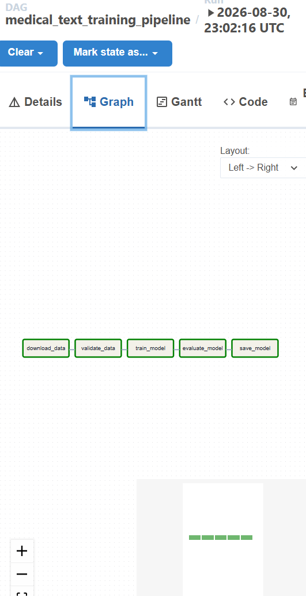
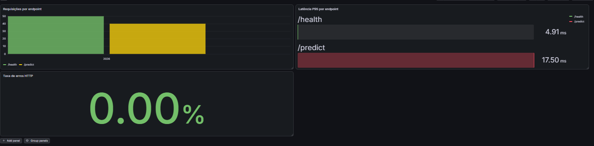

# Tech Challenge — Fase 03

## Machine Learning Engineering — Classificação de Textos Médicos em Produção

Projeto desenvolvido para a **Fase 03 da Pós-Tech em Machine Learning Engineering**, com foco no ciclo de vida de um modelo de Machine Learning em ambiente de produção.

A solução implementa um pipeline de **classificação de textos médicos**, contemplando treinamento, API de inferência, testes automatizados, containerização, CI, orquestração, monitoramento e análise de performance.

---

## Visão geral

O projeto utiliza textos de abstracts médicos como entrada e realiza uma classificação multiclasse utilizando um pipeline composto por:

```text
Texto médico
    ↓
TF-IDF
    ↓
Logistic Regression
    ↓
Classe prevista
```

Além do modelo, foi construída uma arquitetura de MLOps contendo:

```text
                         ┌─────────────────────┐
                         │   Medical Abstracts │
                         │      Dataset        │
                         └─────────┬───────────┘
                                   │
                                   ▼
                         ┌─────────────────────┐
                         │      Airflow        │
                         │ Training Pipeline   │
                         └─────────┬───────────┘
                                   │
                                   ▼
                         ┌─────────────────────┐
                         │ TF-IDF + Logistic   │
                         │     Regression      │
                         └─────────┬───────────┘
                                   │
                                   ▼
                         ┌─────────────────────┐
                         │    model.joblib     │
                         └─────────┬───────────┘
                                   │
                                   ▼
┌─────────────────┐      ┌─────────────────────┐
│ GitHub Actions  │─────▶│      FastAPI        │
│ Ruff / Pytest / │      │ /health /predict   │
│ Docker Build    │      │      /metrics       │
└─────────────────┘      └─────────┬───────────┘
                                   │
                                   ▼
                         ┌─────────────────────┐
                         │     Prometheus      │
                         └─────────┬───────────┘
                                   │
                                   ▼
                         ┌─────────────────────┐
                         │       Grafana       │
                         │ Requests / P95 /    │
                         │       Errors        │
                         └─────────────────────┘
```

Também foi avaliada uma versão do classificador em **ONNX Runtime**, com validação de equivalência e comparação de latência e throughput em relação ao scikit-learn.

---

# Dataset

Foi utilizado o dataset:

**Medical Abstracts — `TimSchopf/medical_abstracts`**

O download é realizado automaticamente através da biblioteca Hugging Face `datasets`, portanto os arquivos brutos não precisam ser armazenados no repositório.

Estrutura utilizada:

```text
condition_label
medical_abstract
```

Quantidade de registros:

| Split | Registros |
|---|---:|
| Treino | 11.550 |
| Teste | 2.888 |
| Total | 14.438 |

O problema possui **5 classes**.

> **Escopo:** o dataset utilizado possui categorias de condições médicas e não rótulos clínicos reais de urgência. Portanto, este projeto demonstra tecnicamente o ciclo de vida de uma solução de classificação de textos médicos em produção e **não deve ser interpretado como sistema clínico de triagem ou apoio à decisão médica**.

Distribuição observada no conjunto de treinamento:

| Classe | Registros |
|---:|---:|
| 1 | 2.530 |
| 2 | 1.195 |
| 3 | 1.540 |
| 4 | 2.441 |
| 5 | 3.844 |

Não foram encontrados valores ausentes nas colunas utilizadas.

O download pode ser reproduzido com:

```bash
poetry run python scripts/download_data.py
```

Os arquivos são gerados localmente em:

```text
data/raw/train.parquet
data/raw/test.parquet
```

---

# Modelo de Machine Learning

O pipeline final utiliza:

- `TfidfVectorizer`
- `LogisticRegression`
- `class_weight="balanced"`
- limitação do vocabulário com `max_features=10_000`

Configuração principal do TF-IDF:

```text
lowercase=True
stop_words="english"
ngram_range=(1, 2)
min_df=2
max_df=0.95
sublinear_tf=True
max_features=10_000
```

O uso de `class_weight="balanced"` foi escolhido após comparação com uma versão sem balanceamento.

Além disso, durante a etapa de otimização foi reduzida a dimensionalidade do TF-IDF de **218.271 para 10.000 features**, configuração que apresentou melhor equilíbrio entre qualidade preditiva e latência.

---

## Resultados do modelo final

Resultados no conjunto de teste:

| Métrica | Resultado |
|---|---:|
| Accuracy | **60,18%** |
| Macro F1 | **0,6045** |
| Weighted F1 | **0,5894** |

Resultados por classe:

| Classe | Precision | Recall | F1-score |
|---:|---:|---:|---:|
| 1 | 0,69 | 0,76 | 0,73 |
| 2 | 0,48 | 0,69 | 0,57 |
| 3 | 0,53 | 0,69 | 0,60 |
| 4 | 0,66 | 0,73 | 0,69 |
| 5 | 0,58 | 0,35 | 0,44 |

O desempenho varia entre as classes, com maior dificuldade ainda observada na classe 5.

As métricas completas são armazenadas em:

```text
models/metrics.json
```

---

# Treinamento

Para treinar o modelo:

```bash
poetry run python src/training/train.py
```

O pipeline completo é salvo como:

```text
models/model.joblib
```

O arquivo contém tanto o TF-IDF quanto o classificador, garantindo que o mesmo pré-processamento utilizado no treinamento seja aplicado durante a inferência.

---

# API de inferência

A aplicação utiliza **FastAPI**.

Endpoints disponíveis:

| Método | Endpoint | Função |
|---|---|---|
| GET | `/health` | Verificação de saúde da API |
| POST | `/predict` | Realiza uma classificação |
| GET | `/metrics` | Expõe métricas para o Prometheus |

Executar localmente:

```bash
poetry run uvicorn app.main:app --reload
```

Documentação Swagger:

```text
http://localhost:8000/docs
```

---

## Exemplo de requisição

```json
{
  "text": "Patient presents with persistent chest pain and cardiovascular symptoms requiring medical evaluation."
}
```

Exemplo de resposta:

```json
{
  "prediction": 4,
  "confidence": 0.73
}
```

A propriedade `confidence` representa a maior probabilidade estimada pelo classificador entre as cinco classes e não deve ser interpretada como confiança clínica.

---

# Testes automatizados

A suíte utiliza **Pytest** e contempla:

- disponibilidade da API;
- endpoint `/health`;
- inferência em `/predict`;
- validação de payload inválido;
- existência e carregamento do modelo;
- formato das probabilidades;
- existência dos datasets;
- schema dos dados;
- ausência de valores nulos;
- validação das classes.

Executar:

```bash
poetry run pytest -v
```

Resultado atual:

```text
11 passed
```

A qualidade do código também é validada com Ruff:

```bash
poetry run ruff check .
```

---

# Docker

A API possui uma imagem Docker própria.

Build:

```bash
docker build -t medical-text-api:latest .
```

Execução:

```bash
docker run --rm -p 8000:8000 medical-text-api:latest
```

Teste:

```bash
curl http://localhost:8000/health
```

Resposta esperada:

```json
{"status":"ok"}
```

---

# Docker Compose

O ambiente completo pode ser iniciado com:

```bash
docker compose up --build
```

Serviços disponíveis:

| Serviço | Porta |
|---|---:|
| FastAPI | `8000` |
| Grafana | `3000` |
| Airflow | `8080` |
| Prometheus | `9090` |

Para finalizar:

```bash
docker compose down
```

---

# CI/CD — GitHub Actions

O projeto possui um workflow automatizado no GitHub Actions executado em pushes e pull requests relacionados à Fase 03.

Nesta implementação, o pipeline cobre **integração contínua e build da imagem Docker**. O deploy em nuvem não é executado automaticamente; a arquitetura de produção em nuvem é apresentada de forma teórica na seção específica deste README.

Workflow:

```text
Checkout
   ↓
Python 3.12
   ↓
Poetry
   ↓
Install dependencies
   ↓
Download dataset
   ↓
Train model
   ↓
Ruff
   ↓
Pytest
   ↓
Docker build
```

Dessa forma, o ambiente do GitHub consegue reconstruir todo o fluxo sem depender dos dados ou do modelo existentes na máquina local.

Arquivo:

```text
.github/workflows/phase3-ci.yml
```

---

# Orquestração com Apache Airflow

O pipeline de treinamento também foi implementado como uma DAG do Airflow.

DAG:

```text
medical_text_training_pipeline
```

Fluxo:

```text
download_data
      ↓
validate_data
      ↓
train_model
      ↓
evaluate_model
      ↓
save_model
```

Função das tarefas:

| Task | Responsabilidade |
|---|---|
| `download_data` | Recupera o dataset |
| `validate_data` | Valida schema, classes e valores ausentes |
| `train_model` | Treina TF-IDF + Logistic Regression |
| `evaluate_model` | Calcula e salva métricas |
| `save_model` | Promove uma cópia do modelo como artefato de produção |

Interface:

```text
http://localhost:8080
```

## Execução do pipeline



---

# Monitoramento

A API possui instrumentação com `prometheus-client`.

São monitoradas duas métricas customizadas principais:

```text
api_requests_total
```

Quantidade total de requisições, segmentada por:

- método;
- endpoint;
- status HTTP.

E:

```text
api_request_latency_seconds
```

Histograma de latência das requisições.

---

## Prometheus

O Prometheus coleta automaticamente:

```text
http://api:8000/metrics
```

Intervalo de coleta:

```text
5 segundos
```

Interface local:

```text
http://localhost:9090
```

---

# Grafana

O Grafana utiliza o Prometheus como datasource e possui dashboard provisionado automaticamente pelo Docker Compose.

O dashboard inclui:

### Requisições por endpoint

Permite visualizar o volume de utilização da API.

### Latência P95

Exibe o percentil 95 de latência por endpoint.

### Taxa de erros HTTP

Monitora requisições com status `5xx`.

Exemplo observado durante os testes locais:

```text
/health   P95 ≈ 4,91 ms
/predict  P95 ≈ 17,50 ms
Taxa de erros = 0%
```

Os valores representam uma execução local específica e podem variar conforme hardware, carga e ambiente.

## Dashboard



Interface:

```text
http://localhost:3000
```

---

# Otimização de performance

O critério de performance foi tratado em duas etapas complementares:

1. **redução da dimensionalidade do TF-IDF**;
2. **conversão do classificador para ONNX Runtime**.

Os experimentos foram mantidos separados porque utilizam protocolos de benchmark diferentes.

---

## 1. Redução da dimensionalidade do TF-IDF

O modelo baseline utilizava um vocabulário de **218.271 features**.

Foram testadas configurações com 20.000, 10.000 e 5.000 features. A configuração com:

```text
max_features=10_000
```

apresentou o melhor equilíbrio entre qualidade preditiva e desempenho.

| Métrica | Baseline | Otimizado |
|---|---:|---:|
| Features | 218.271 | **10.000** |
| Accuracy | 58,73% | **60,18%** |
| Macro F1 | 0,5884 | **0,6045** |
| Latência média | 0,8135 ms | **0,7917 ms** |
| P95 | 1,0656 ms | **1,0293 ms** |

Resultados observados:

- redução de aproximadamente **95,4% no espaço de features**;
- redução de **2,69% na latência média**;
- redução de **3,40% na latência P95**;
- aumento de **2,77% no throughput**;
- ganho de **1,45 ponto percentual em accuracy**.

Para reduzir o efeito de oscilações do ambiente local, a validação final foi realizada com **5 rodadas independentes**, cada uma contendo **50 chamadas de warm-up e 1.000 inferências**, e a comparação utilizou a mediana das rodadas.

Os resultados são armazenados em:

```text
models/feature_pruning_benchmark.json
models/feature_pruning_validation.json
```

---

## 2. Otimização com ONNX Runtime

Após a redução do vocabulário para 10.000 features, também foi avaliada a execução do classificador com **ONNX Runtime**.

A tentativa inicial de converter o pipeline textual completo apresentou divergências relacionadas ao processamento do `TfidfVectorizer`. Para preservar a equivalência entre as previsões, a estratégia final manteve o **mesmo TF-IDF do scikit-learn** e converteu somente a `LogisticRegression` para ONNX.

O modelo ONNX gerado possui aproximadamente:

```text
0,24 MB
```

A equivalência foi validada em 100 amostras:

```text
Samples compared: 100
Matching predictions: 100
Agreement: 100%
```

### Benchmark end-to-end

Neste experimento foi considerado o fluxo necessário para a inferência com TF-IDF e classificador.

Foram utilizadas **20 chamadas de warm-up e 300 inferências**.

| Métrica | Scikit-learn | ONNX Runtime |
|---|---:|---:|
| Média | 1,0743 ms | **1,0019 ms** |
| P50 | 0,9736 ms | **0,9050 ms** |
| P95 | 1,7004 ms | **1,5906 ms** |
| P99 | **2,0133 ms** | 2,2530 ms |
| Throughput | 930,81 req/s | **998,12 req/s** |

Resultado:

- **6,74% de redução na latência média**;
- **7,23% de aumento no throughput**;
- melhora também em P50 e P95;
- o P99 apresentou piora nesta execução, evidenciando a variabilidade natural de medições tão curtas em ambiente local.

### Benchmark do classificador isolado

Também foi executado um benchmark somente da etapa de classificação, com as features TF-IDF previamente calculadas.

| Métrica | Scikit-learn | ONNX Runtime |
|---|---:|---:|
| Média | 0,2199 ms | **0,0543 ms** |
| P50 | 0,1719 ms | **0,0334 ms** |
| P95 | 0,3927 ms | **0,1323 ms** |
| P99 | 0,6243 ms | **0,2608 ms** |
| Throughput | 4.547,14 req/s | **18.426,60 req/s** |

Resultado:

- **75,32% de redução na latência média do classificador**;
- **305,24% de aumento no throughput**.

A diferença entre o ganho do classificador isolado e o ganho end-to-end mostra que parte do custo total da inferência está no pré-processamento TF-IDF. Dessa forma, a otimização do classificador é expressiva, mas o ganho percebido pelo pipeline completo é menor.

---

## Conclusão da otimização

A etapa de otimização demonstrou ganho mensurável de performance sem perda de qualidade preditiva.

A redução do vocabulário do TF-IDF melhorou simultaneamente a qualidade do modelo e a latência. Em seguida, o ONNX Runtime também apresentou ganho no benchmark end-to-end e ganho ainda mais expressivo quando o classificador foi medido isoladamente.

A API principal permanece utilizando o pipeline `model.joblib`, já com o TF-IDF otimizado para **10.000 features**, garantindo que pré-processamento e classificação sejam carregados em um único artefato. O ONNX Runtime é mantido como experimento adicional de aceleração e pode ser reproduzido pelos scripts de otimização.

Resultados completos:

```text
models/benchmark.json
models/benchmark_classifier.json
models/feature_pruning_benchmark.json
models/feature_pruning_validation.json
```

---

# Arquitetura proposta para produção em nuvem

A aplicação foi construída localmente com containers, mas uma arquitetura de produção poderia utilizar serviços gerenciados em nuvem.

Uma possibilidade seria:

```text
Cliente
   ↓
HTTPS
   ↓
Cloud Run
FastAPI container
   ↓
Modelo de ML
   │
   ├──── métricas / logs
   ↓
Observabilidade

Artifact Registry
   ↑
Docker Image
   ↑
GitHub Actions
```

Para o treinamento:

```text
Dataset
   ↓
Pipeline Airflow
   ↓
Validação
   ↓
Treinamento
   ↓
Avaliação
   ↓
Novo modelo
```

O modelo de atendimento **online/real-time** foi escolhido porque a aplicação expõe uma API REST para classificação sob demanda.

O uso de uma plataforma serverless para a API permite:

- escalabilidade automática;
- redução de infraestrutura operacional;
- execução baseada em containers;
- facilidade de versionamento;
- possibilidade de rollback;
- cobrança associada ao uso.

Em um ambiente corporativo, Airflow poderia ser executado em uma solução gerenciada de orquestração e os artefatos do modelo armazenados em um serviço de objetos/model registry.

> A arquitetura cloud apresentada é uma proposta de produção. A implementação deste repositório utiliza Docker Compose localmente.

---

# Estrutura do projeto

```text
tech-challenge-fase-03/
│
├── airflow/
│   └── dags/
│       └── retrain_model.py
│
├── app/
│   ├── main.py
│   ├── metrics.py
│   └── schemas.py
│
├── data/
│   ├── raw/
│   └── processed/
│
├── docs/
│   └── images/
│
├── models/
│   ├── metrics.json
│   ├── benchmark.json
│   ├── benchmark_classifier.json
│   ├── feature_pruning_benchmark.json
│   └── feature_pruning_validation.json
│
├── monitoring/
│   ├── prometheus.yml
│   └── grafana/
│
├── scripts/
│   ├── download_data.py
│   └── validate_data.py
│
├── src/
│   ├── optimization/
│   │   ├── benchmark.py
│   │   ├── benchmark_classifier.py
│   │   ├── benchmark_feature_pruning.py
│   │   ├── validate_feature_pruning.py
│   │   ├── convert_onnx.py
│   │   └── validate_onnx.py
│   │
│   └── training/
│       ├── train.py
│       └── evaluate.py
│
├── tests/
│   ├── test_api.py
│   ├── test_data.py
│   └── test_model.py
│
├── Dockerfile
├── Dockerfile.airflow
├── docker-compose.yml
├── pyproject.toml
├── poetry.lock
├── requirements-airflow.txt
└── README.md
```

---

# Como executar o projeto

## 1. Clonar o repositório

```bash
git clone https://github.com/nickysll/Machine-Learning-Engineering.git
cd Machine-Learning-Engineering/tech-challenge-fase-03
```

## 2. Instalar as dependências

Requisitos:

```text
Python 3.12
Poetry
Docker
Docker Compose
```

Instalação:

```bash
poetry install --with dev --no-root
```

## 3. Baixar os dados

```bash
poetry run python scripts/download_data.py
```

## 4. Validar os dados

```bash
poetry run python scripts/validate_data.py
```

## 5. Treinar o modelo final

```bash
poetry run python src/training/train.py
```

## 6. Avaliar

```bash
poetry run python src/training/evaluate.py
```

## 7. Executar os testes

```bash
poetry run pytest -v
```

## 8. Executar análise estática

```bash
poetry run ruff check .
```

## 9. Reproduzir a otimização do TF-IDF

```bash
poetry run python src/optimization/benchmark_feature_pruning.py
poetry run python src/optimization/validate_feature_pruning.py
```

## 10. Gerar e validar o modelo ONNX

```bash
poetry run python src/optimization/convert_onnx.py
poetry run python src/optimization/validate_onnx.py
```

## 11. Executar os benchmarks ONNX

```bash
poetry run python src/optimization/benchmark.py
poetry run python src/optimization/benchmark_classifier.py
```

## 12. Subir a solução completa

> Antes do build da API, execute as etapas de download e treinamento para que `data/raw/` e `models/model.joblib` existam localmente.

Em Linux/WSL:

```bash
echo "AIRFLOW_UID=$(id -u)" > .env
docker compose up --build
```

Serviços:

```text
FastAPI:    http://localhost:8000
Swagger:    http://localhost:8000/docs
Airflow:    http://localhost:8080
Prometheus: http://localhost:9090
Grafana:    http://localhost:3000
```

Para encerrar:

```bash
docker compose down
```

---

# Tecnologias

- Python 3.12
- Poetry
- Pandas
- NumPy
- Scikit-learn
- TF-IDF
- Logistic Regression
- FastAPI
- Pydantic
- Pytest
- Ruff
- Docker
- Docker Compose
- GitHub Actions
- Apache Airflow
- Prometheus
- Grafana
- ONNX
- ONNX Runtime
- skl2onnx
- Hugging Face Datasets

---

# Principais resultados

O projeto demonstrou um fluxo completo de Machine Learning Engineering:

```text
dados
  ↓
validação
  ↓
treinamento
  ↓
avaliação
  ↓
API
  ↓
testes
  ↓
container
  ↓
CI / build
  ↓
orquestração
  ↓
monitoramento
  ↓
otimização
  ↓
benchmark
```

Principais resultados técnicos:

- modelo final com **60,18% de accuracy**, **Macro F1 de 0,6045** e **Weighted F1 de 0,5894**;
- redução do espaço TF-IDF de **218.271 para 10.000 features**;
- redução de **2,69% na latência média** e **3,40% no P95** após a redução dimensional;
- ONNX Runtime com **6,74% de redução na latência média end-to-end** e **7,23% de aumento no throughput**;
- no classificador isolado, ONNX apresentou **75,32% de redução na latência média** e **305,24% de aumento no throughput**;
- equivalência de **100% das previsões** entre scikit-learn e ONNX nas 100 amostras utilizadas na validação;
- pipeline de CI/build automatizado, DAG Airflow funcional e stack de monitoramento com Prometheus e Grafana.

O principal aprendizado da análise de performance foi que **otimização deve ser medida e não presumida**. A primeira estratégia de conversão do pipeline completo não foi adotada devido a divergências no pré-processamento textual. A solução final preservou o TF-IDF do scikit-learn, reduziu sua dimensionalidade e converteu apenas o classificador para ONNX, permitindo obter ganhos mensuráveis e manter equivalência de previsões.

---

## Status

✅ Implementação técnica concluída  
✅ Modelo e avaliação  
✅ API de inferência  
✅ Testes automatizados  
✅ Containerização  
✅ CI/build com GitHub Actions  
✅ Orquestração com Airflow  
✅ Monitoramento com Prometheus e Grafana  
✅ Otimização do TF-IDF  
✅ Conversão e validação ONNX  
✅ Benchmarks de latência e throughput  
✅ Decisão arquitetural de nuvem documentada  

---

## Autora

**Nicoly da Silva Moreira**

Tech Challenge — Fase 03  
Pós-Tech — Machine Learning Engineering